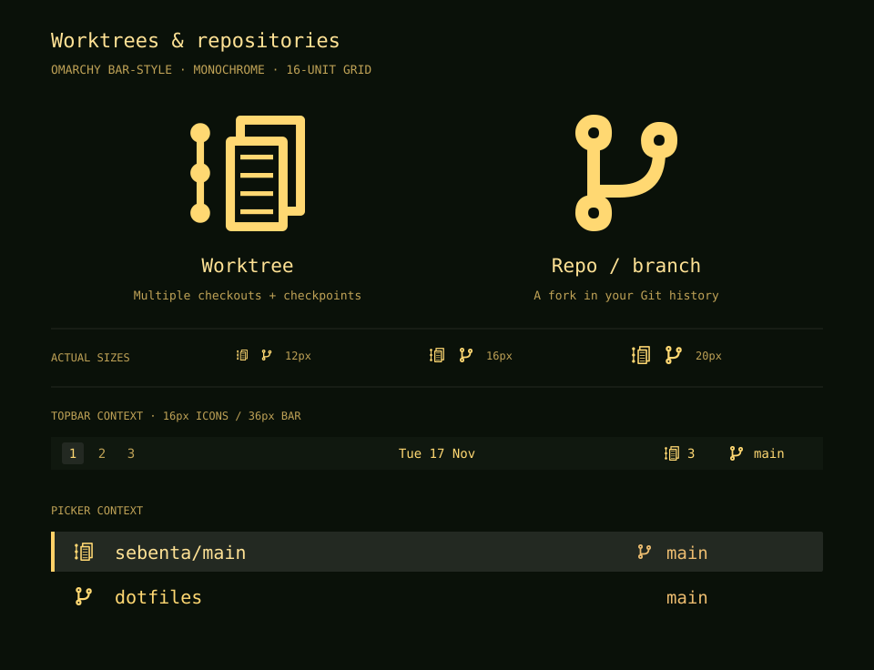

# Picker Icons

Original monochrome companion glyphs for the repository/worktree picker:

| Codepoint | Source | Meaning |
| --- | --- | --- |
| `U+F5000` | `worktree.svg` | Multiple checkouts, with a checkpoint rail |
| `U+F5001` | `repo-branch.svg` | Repository or Git branch |

The worktree file has four equal-width, evenly spaced thin lines. The SVGs
use a 16-unit canvas and `currentColor`, with Ember Grove gold as the default.
The font inherits text color from the terminal.



`PickerIcons.ttf` is the prebuilt font. Install it with:

```sh
bash font/picker-icons/install.sh
```

The Ghostty step in `setup_environment.sh` also installs it. Ghostty maps
only `U+F5000-U+F5001` to **Picker Icons**. After installing the font, fully
restart Ghostty so it discovers the new font. An existing process can retain
its old font cache across configuration reloads and new tabs/windows.
On Linux, open a fresh process without closing existing terminals:

```sh
ghostty --gtk-single-instance=false
```

The picker uses two spaces after each private-use glyph to give square
artwork room and keep the following text separated.

To rebuild after editing the SVGs:

```sh
uv run font/picker-icons/build.py
bash font/picker-icons/install.sh
```

The build script pins and isolates its Python dependencies using `uv`.
It expands SVG strokes, unites overlapping shapes, preserves holes,
and converts curves into TrueType outlines. Font generation is deterministic.

Quick terminal sample:

```sh
printf '\U000f5000  sebenta/main    \U000f5001  main\n\U000f5001  dotfiles\n'
```
